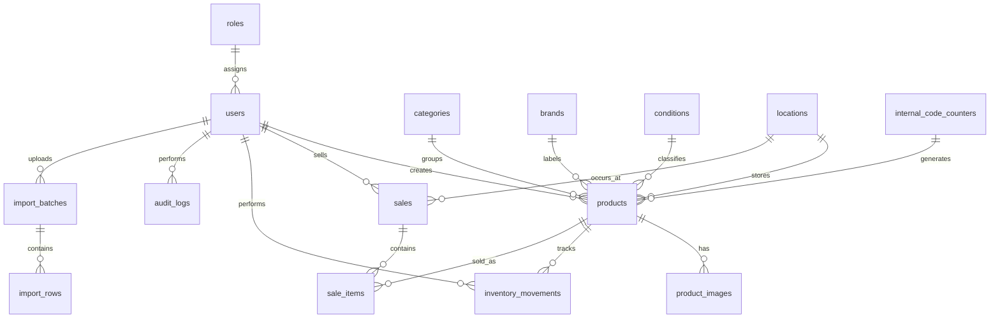

# Diagrama ER RAGUILEX - Fase 1

## Notas de diseno

- `products` representa una unidad fisica, no un SKU agregado.
- `products.internal_code` conserva codigos existentes como `TN-00001`.
- `products.qr_token` es unico y opaco; el QR no debe contener costo, precio ni datos sensibles.
- `sale_items.purchase_cost_snapshot` preserva la utilidad historica.
- `inventory_movements` y `audit_logs` mantienen trazabilidad.
- `import_batches` e `import_rows` conservan datos originales y normalizados para auditoria del Excel.

